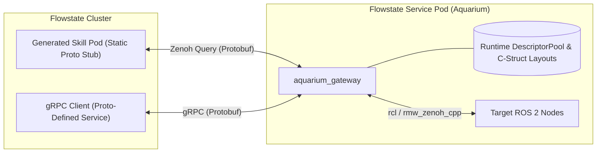

# Architecture & Internals

`aquarium` decouples `aquarium_gateway` from compile-time ROS 2 message headers
by combining design-time ROS 2 Type Description Service (TDS) introspection,
runtime Protobuf reflection, and dynamic C-struct memory marshalling.

## 1. Design-Time ROS 2 Introspection

Rather than linking custom ROS 2 `.hpp` message headers into the assistant or
gateway, `aquarium_setup_assistant` discovers message definitions over the
live ROS 2 graph and records them into [`aquarium.yaml`](aquarium_yaml.md):

* **Type Description Service (TDS):** Nodes in ROS 2 expose a
  `~/get_type_description` service
  (`type_description_interfaces/srv/GetTypeDescription`) returning the full
  structural hierarchy of a topic, service, or action (primitive field types,
  bounded/unbounded sequences, fixed arrays, and nested submessages).
* **Type Hash Discovery via Zenoh Liveliness & Typesupport:** Calling
  `GetTypeDescription` requires the interface's `RIHS01` type hash. For topics
  and services, the assistant queries `rmw_zenoh_cpp`'s `@ros2_lv/**`
  liveliness keyspace directly over a Zenoh session (`MP`/`MS` tokens for
  topics, `SS` tokens for services) and extracts the compiled `RIHS01` hash
  from the liveliness key expression. For actions, it resolves the hash from C
  action typesupport when installed locally and falls back to `@ros2_lv/**`
  liveliness tokens otherwise.

## 2. Statically-Typed Skill Containers vs. Dynamic Gateway

`aquarium build` splits runtime responsibilities cleanly across container
boundaries:

* **Flowstate Skill Pods (Static):** Each selected interface in `aquarium.yaml`
  is compiled at build time into an explicit `.proto` schema, binary descriptor
  set (`.desc`), and lightweight C++ skill container. Because the skill
  manifests register static Protobuf descriptors in the Flowstate catalog, the
  Flowstate web UI renders parameter widgets natively with zero frontend
  changes. At runtime, each skill pod serializes its Protobuf request and
  issues a Zenoh query to `aquarium_gateway`.
* **Flowstate Service Pod (`aquarium_gateway`):** Packages the target ROS 2
  workspace (so runtime typesupport `.so` libraries are present in the
  container's install space) alongside the generic `aquarium_gateway` binary,
  which never needs custom message headers compiled into it.

## 3. Runtime Protobuf Reflection

At startup, `aquarium_gateway` parses `types` and `interfaces` from
`aquarium.yaml` and programmatically constructs
`google::protobuf::FileDescriptorProto` definitions in memory, registering them
in a local `google::protobuf::DescriptorPool`. Incoming Zenoh queries (and
generic gRPC calls via `grpc::ServerGenericBidiReactor`) are deserialized into
`google::protobuf::DynamicMessage` instances via `DynamicMessageFactory` and
inspected through `google::protobuf::Reflection`.

## 4. Dynamic C-Struct Layout & RMW Dispatch

To invoke ROS 2 endpoints without compile-time C++ message types,
`aquarium_gateway` (`src/gateway/serialization.cpp`) computes ABI-aligned C
structure layouts (`ComputeDynamicLayout`) matching `rosidl_generator_c` memory
representations:

* **Primitive & Fixed-Array Alignment:** Aligns scalar fields to 1-, 2-, 4-, or
  8-byte boundaries, lays out fixed-size arrays (`T[N]`) inline with
  `N * sizeof(T)` bytes, and pads struct tails to the largest member alignment.
* **Strings & Sequences:** Initializes and populates
  `rosidl_runtime_c__String`, `GenericPrimitiveSequence`, and
  `GenericMessageSequence` structs in place (handling bounded and unbounded
  sequences as well as recursive nested submessage elements).
* **Transport Dispatch:**
  * **`ros_service`:** Sends type-erased request C-struct buffers via cached
    `rcl_client_t` handles (`rcl_send_request` / `rcl_take_response`).
  * **`ros_action_client`:** Drives goal submission, result waiting, and
    status mapping through cached `rcl_action_client_t` handles.
  * **`ros_topic_subscription`:** Subscribes via `rclcpp::GenericSubscription`,
    deserializes incoming `rcl_serialized_message_t` buffers via
    `rmw_deserialize` into a mutex-guarded C-struct cache, and serves cached or
    condition-variable-waited responses to Zenoh queries.
